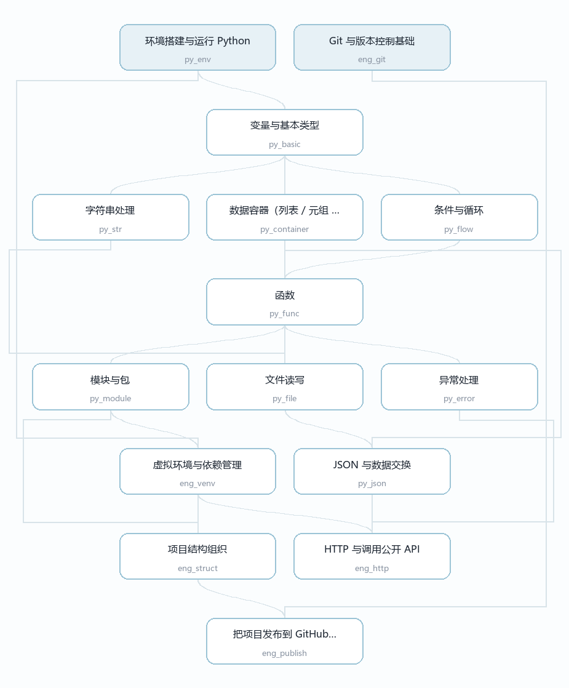

# AgtStu

> 把学习路径当作**依赖图**来管理的开源学习工具 —— 从 Python 基础到 Agent 开发。

[](LICENSE)
[](https://www.python.org/)
[](https://github.com/1fish4/agtstu/releases)
[](https://github.com/1fish4/agtstu/actions)
[](https://gitee.com/not-even-xianyu-can-handle-it/agtstu)

**在线浏览 → <https://1fish4.github.io/agtstu/>**（依赖图可视化 · 进度模拟 · 目标路径规划）



## 为什么需要它

学完 Python 语法，和能交付一个完整项目，中间隔着一道巨大的鸿沟。

网上的学习资料不缺，缺的是四样东西：

1. **一条完整的路线** —— 课程是拼凑的，要看这个老师一段、那个老师一段
2. **明确的验收标准** —— 学完一章，不知道自己到底会不会
3. **学到哪算够的边界** —— 要么在基础章节里死磕深度，要么浅尝辄止，没人给标准
4. **真实的踩坑记录** —— 所有人都给你链接，没人告诉你「真正卡人的地方在哪」

AgtStu 针对这四点：

| 问题 | AgtStu 的做法 |
|------|--------------|
| 路线碎片化 | 把路径写成**依赖图数据**，程序能算出「现在能学什么」「还差哪几步」 |
| 没有验收标准 | 每个节点带**可勾选的验收清单** —— 完成即合格，不设标准答案 |
| 不知道学到哪算够 | 每个节点标注**掌握档位**（了解 / 会用 / 熟练），并写明「现在不用管什么」 |
| 只有链接没有经验 | 每个节点带**作者真实踩过的坑** |

> **学习路径不是一份清单，是一张图。** 一个知识点可以有多个前置，也能解锁多个后继。
> 用清单表达会丢掉这些关系，用数据表达才能算出来。

## 快速开始

```bash
pip install pyyaml

git clone https://github.com/1fish4/agtstu.git
cd agtstu
python -m agtstu next
```

输出：

```
现在可以学（2 个）：

  ○ py_env  —  环境搭建与运行 Python
  ○ eng_git  —  Git 与版本控制基础
```

## 命令

| 命令 | 作用 |
|------|------|
| `agtstu next` | **我下一步能学什么** —— 前置已全部满足的节点 |
| `agtstu list` | 按正确学习顺序列出全部节点，标注状态 |
| `agtstu show <id>` | 查看某个节点的掌握程度、知识点、验收标准、参考项目、常见坑 |
| `agtstu path <id>` | 达成某个目标需要走的完整路径 |
| `agtstu done <id>` | 标记节点为已完成 |
| `agtstu undo <id>` | 取消完成标记 |
| `agtstu stats` | 按阶段统计进度 |
| `agtstu check` | 校验路径数据（循环依赖 / 悬空引用 / 孤立节点）|

进度保存在 `~/.agtstu/progress.json`，不随项目目录变动而丢失。

### 几个例子

```bash
$ agtstu path eng_http
达成「HTTP 与调用公开 API」还需要 12 步：

   1. 环境搭建与运行 Python  (py_env)
   2. 变量与基本类型  (py_basic)
   ...
  12. HTTP 与调用公开 API  (eng_http)  ← 目标
```

```bash
$ agtstu show py_basic
· 变量与基本类型  (py_basic)   状态：缺 py_env

掌握程度：熟练
  必须达到：不看笔记写出「接收输入 → 转换类型 → 计算 → 格式化输出」的完整脚本
  到这里就够：看到 TypeError / ValueError 能立刻判断是哪个值的类型不对
  现在不用管：IEEE 754 浮点表示、整数的内存布局、字符串的编码实现

验收标准
  - 能写一个接收输入、做转换、输出结果的小脚本
  - 能解释 input() 返回的是什么类型
  - 能说出 / 与 // 的区别

常见坑（作者踩过的）
  - 输入 7 后 if answer == 7 永远不成立 —— input() 返回的是字符串
  - / 是浮点除法，// 才是整除；想取整别用 /
  - 浮点数有精度问题，0.1 + 0.2 不等于 0.3，比较时要留意
```

## 数据格式

学习路径写在 `agtstu/data/path.yaml`，**改内容不需要改代码**：

```yaml
- id: py_func
  title: 函数
  stage: 阶段一 · Python 与工程基础
  requires: [py_flow, py_container]     # ← 这就是依赖图的边

  # 学到哪算够 —— 三档：了解 / 会用 / 熟练
  mastery:
    tier: 熟练
    must: 能把重复代码抽成函数；参数用对；返回值清晰
    enough: 写超过 30 行的脚本时会自然想「这段该不该抽成函数」
    beyond: 装饰器、闭包、递归 —— 分水岭，等能熟练写函数之后再回来

  skills:
    - title: 位置参数与关键字参数
      what: 按位置传要记顺序，关键字传不看顺序
      example: |
        def power(base, exp=2):
            return base ** exp
        print(power(3, exp=3))
      output: |
        27

  acceptance:
    - 能把一段重复代码抽成函数
    - 能解释可变默认参数为什么危险

  project:
    name: 把猜数字改造成函数版
    note: 拆成生成答案、判断猜测、统计次数几个函数

  pitfalls:
    - symptom: 第二次调用时默认参数里残留上一次的数据
      scene: |
        def add_item(item, items=[]):
            items.append(item)
      why: 默认值在函数定义时只创建一次，之后每次调用共享同一个列表
      fix: 默认值写 None，函数内再赋值为 []
      search: python 可变默认参数 陷阱 mutable default argument
```

改完运行 `agtstu check` 验证。

## 项目结构

```
agtstu/
├── agtstu/
│   ├── model.py        # 数据模型：一个「节点」是什么
│   ├── loader.py       # 从 YAML 加载路径数据
│   ├── graph.py        # 依赖图引擎（核心）
│   ├── progress.py     # 进度读写
│   ├── cli.py          # 命令行界面
│   └── data/path.yaml  # 学习路径数据
├── tests/
│   ├── test_graph.py   # 引擎算法测试
│   └── test_cli.py     # 命令行测试
├── tools/
│   ├── build_site.py   # 把 path.yaml 编译成静态站
│   └── template.html   # 展示页模板
├── docs/
│   ├── index.html      # 编译产物：展示页（GitHub Pages 托管）
│   └── images/         # 配图
├── ROADMAP.md          # 分期计划
├── DEVLOG.md           # 开发日志
└── CHANGELOG.md        # 版本变更
```

## 核心技术

引擎把学习路径当作**有向无环图**，用到的算法：

| 能力 | 算法 |
|------|------|
| 校验内容是否有循环依赖 | DFS 三色标记 |
| 列出正确学习顺序 | Kahn 拓扑排序 |
| 算「现在能学什么」 | 拓扑前沿（入度归零） |
| 算「达成目标还差什么」 | 祖先集合 + 拓扑排序 |

**为什么循环依赖检测重要**：一旦 A 依赖 B、B 又依赖 A，这两个节点会**永远无法解锁**。
在纸上画路线图几乎不可能发现这种问题，程序一跑就查出来了。

## 开发

```bash
python -m venv .venv
# Windows: .venv\Scripts\activate
# macOS/Linux: source .venv/bin/activate

pip install -e ".[dev]"
pytest
```

### 生成展示页

`docs/index.html` 是**编译产物，不手写**：

```bash
python tools/build_site.py
```

它读取 `agtstu/data/path.yaml`，先跑一遍数据校验（有环 / 悬空引用 / 孤立节点就中止构建），
再编译成**单文件站点** —— 数据内嵌其中，没有任何外部依赖，双击也能打开。
GitHub Pages 直接托管 `docs/` 目录。

> 改完内容记得重新构建并提交 `docs/index.html`，否则线上页面不会更新。

## 路线图

见 [ROADMAP.md](ROADMAP.md)。当前处于**一期：路径引擎**阶段。

## 贡献

欢迎提交 Issue 与 PR。特别欢迎：

- **补充学习路径节点** —— 尤其是你踩过的坑
- **报告数据错误** —— 依赖关系写错、验收标准不清晰
- **新增配套项目**

新增节点请遵循 [CONTRIBUTING.md](CONTRIBUTING.md) 中的数据格式。

## 关于收录他人项目

本项目**只收录链接，不转载他人内容**。节点中的参考项目若指向外部仓库，
必须标注出处。转载需要逐项目核对原项目许可证：

| 原项目许可证 | 能否转载 |
|------------|:---:|
| MIT / Apache-2.0 / BSD | 可以，但必须保留版权声明 |
| GPL / AGPL | 谨慎，有传染性 |
| 没有 LICENSE 文件 | **不可以** |

## 许可证

本项目采用 [MIT License](LICENSE)。
